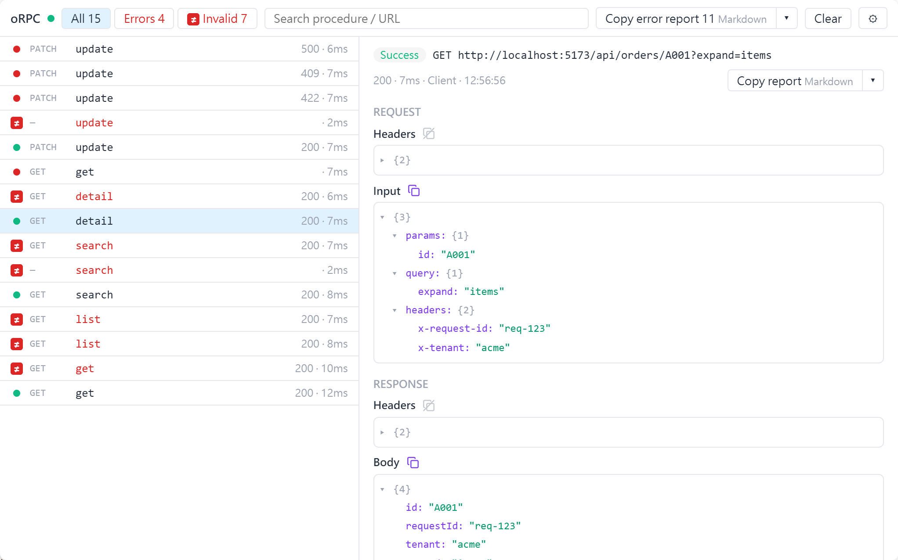
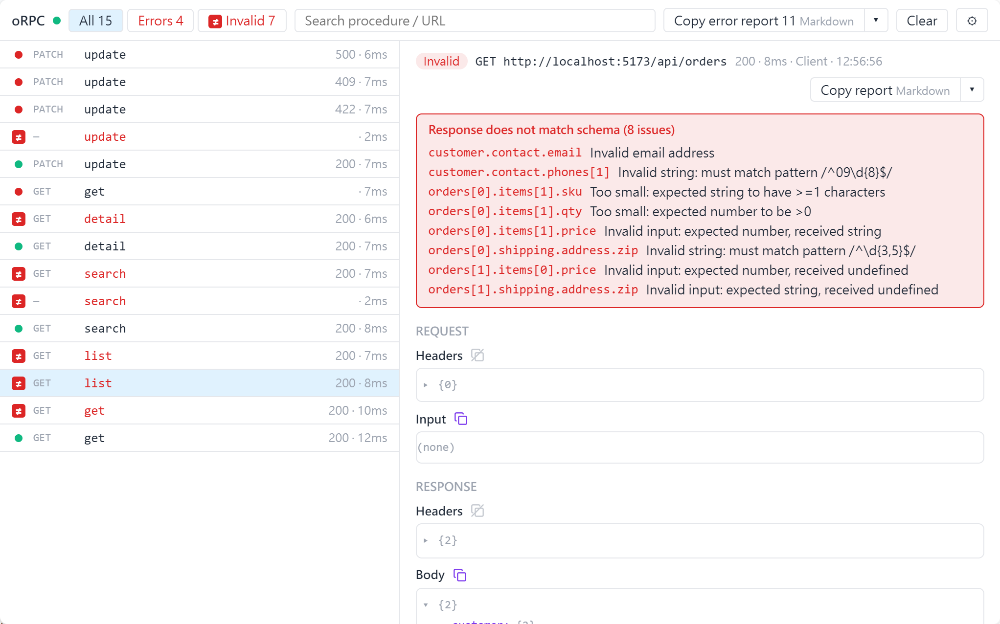

<p align="center">
  <a href="https://github.com/0224071/orpc-inspector/actions/workflows/ci.yml"></a>
  <a href="./LICENSE"></a>
</p>

# orpc-inspector

> DevTools panel for [oRPC](https://orpc.dev) calls

English | [繁體中文](./README.zh-TW.md)

See every oRPC call your app makes (input, output, errors, validation issues, headers) in a DevTools panel.

<picture>
  <source media="(prefers-color-scheme: dark)" srcset="./docs/images/panel-calls-dark.png">
  
</picture>

<picture>
  <source media="(prefers-color-scheme: dark)" srcset="./docs/images/panel-validation-dark.png">
  
</picture>

> [!NOTE]
> Work in progress, not yet published to npm.

## Features

- 🔍 **Every call in one place**: input, output, errors, [validation issues](#validation-issues) and headers, client and [SSR](./docs/guide/ssr.md)
- 🛠️ **DevTools dock**: Vite DevTools for Vue, React and other Vite apps; Nuxt DevTools v4 for Nuxt
- 🌐 **Readable errors**: [zod messages in your language](./docs/guide/zod-locale.md), [error reports](./docs/guide/error-reports.md) for Markdown, Discord or LINE
- 🔒 **Sensitive headers masked**: `authorization`, `cookie` and similar headers are hidden in the panel and in copied reports, including the response headers a non-oRPC backend's error carries in its data; SSR records replace them with `***` before they leave the server
- 📦 **Zero cost in production**: production builds get a no-op unless you [opt in](./docs/guide/production.md)

## Vite (Vue / React / other frameworks)

Requires Vite 8.3+, `@vitejs/devtools` 0.8 and `@orpc/client` / `@orpc/contract` 1.16 or later within 1.x.

1. Install:

   ```sh
   pnpm add @orpc/client@^1.16.0 @orpc/contract@^1.16.0
   pnpm add -D orpc-inspector @vitejs/devtools@^0.8.0 vite@^8.3.0
   ```

2. In `vite.config.ts`, turn on DevTools and add `orpcInspector()` next to your framework plugin:

   ```ts
   import vue from '@vitejs/plugin-vue' // or react(), …
   import { orpcInspector } from 'orpc-inspector/vite'
   import { defineConfig } from 'vite'

   export default defineConfig({
     devtools: true,
     plugins: [
       vue(),
       orpcInspector(),
     ],
   })
   ```

3. Add `OrpcInspectorPlugin` to your oRPC link:

   ```ts
   import { createORPCClient } from '@orpc/client'
   import { RPCLink } from '@orpc/client/fetch'
   import { OrpcInspectorPlugin } from 'orpc-inspector'

   const link = new RPCLink({
     url: `${location.origin}/rpc`,
     plugins: [
       new OrpcInspectorPlugin(),
     ],
   })

   export const client = createORPCClient(link)
   ```

4. Run `vite` and open **oRPC** in the DevTools dock. Its badge counts errors and validation failures. The first time, the dock asks for the auth code printed by the dev server (see [Vite DevTools](https://devtools.vite.dev/errors/dtk0013)).

The inspector only watches the client. The backend can be any server your link talks to: an oRPC server mounted with an [adapter](https://orpc.dev/docs/adapters/node-http), or an existing REST API through [`OpenAPILink`](https://orpc.dev/docs/openapi/client/openapi-link).

## Nuxt

Requires Nuxt 4.6+, Nuxt DevTools v4 and `@orpc/client` / `@orpc/contract` 1.16 or later within 1.x. Nuxt DevTools v3 (the default in Nuxt 4.6) has no dock and is not supported.

1. Install:

   ```sh
   pnpm add @orpc/client@^1.16.0 @orpc/contract@^1.16.0
   pnpm add -D orpc-inspector @nuxt/devtools@4 @nuxt/kit@^4.6.0
   ```

2. In `nuxt.config.ts`:

   ```ts
   export default defineNuxtConfig({
     devtools: { enabled: true },
     modules: ['orpc-inspector/nuxt'],
   })
   ```

3. In the Nuxt plugin that creates your oRPC client, add the auto-imported `useOrpcInspectorPlugin()`. Create the link inside the plugin, not at module level, so SSR calls are recorded per request:

   ```ts
   // app/plugins/orpc.ts
   import { createORPCClient } from '@orpc/client'
   import { RPCLink } from '@orpc/client/fetch'

   export default defineNuxtPlugin(() => {
     const link = new RPCLink({
       url: `${useRequestURL().origin}/rpc`,
       plugins: [
         useOrpcInspectorPlugin(),
       ],
     })
     return {
       provide: {
         client: createORPCClient(link),
       },
     }
   })
   ```

4. Run `nuxt dev` and open **oRPC** in the DevTools dock. The first time, enter the auth code printed by the dev server (see [Nuxt DevTools](https://nuxt.com/modules/devtools/upgrading-to-v4)).

The backend can be any server: an oRPC server with the [Nuxt adapter](https://orpc.dev/docs/adapters/nuxt), or an existing REST API through [`OpenAPILink`](https://orpc.dev/docs/openapi/client/openapi-link).

## Validation issues

The inspector shows the issues oRPC reports; it does not validate anything itself.

- **On the client, with any backend**: define your API as an oRPC contract and add [`RequestValidationPlugin`](https://orpc.dev/docs/plugins/request-validation) and [`ResponseValidationPlugin`](https://orpc.dev/docs/plugins/response-validation) to the link. Invalid input is marked *not sent*. A response that does not match the contract lists every field that failed, as in the screenshot above.
- **From an oRPC server**: when the server rejects the input with `BAD_REQUEST` and `data.issues`, the call is marked as rejected by the server, with the same field list.
- When the server's own output validation fails, it returns a plain 500 with no issues (see [Troubleshooting](./docs/guide/troubleshooting.md)).

For example, with a REST backend (`pnpm add @orpc/openapi-client@^1.16.0`):

```ts
import type { ContractRouterClient } from '@orpc/contract'
import { createORPCClient } from '@orpc/client'
import { RequestValidationPlugin, ResponseValidationPlugin } from '@orpc/contract/plugins'
import { OpenAPILink } from '@orpc/openapi-client/fetch'
import { OrpcInspectorPlugin } from 'orpc-inspector'
import { contract } from './contract' // built with `oc` from @orpc/contract

const link = new OpenAPILink(contract, {
  url: `${location.origin}/api`,
  plugins: [
    new OrpcInspectorPlugin(),
    new RequestValidationPlugin(contract),
    new ResponseValidationPlugin(contract),
  ],
})

export const client: ContractRouterClient<typeof contract> = createORPCClient(link)
```

## Panel not showing?

See [Troubleshooting](./docs/guide/troubleshooting.md). The most common cause: the panel URL was opened in its own tab. Open it from the DevTools dock instead.

## Guides

| I want to… | Guide |
|---|---|
| Use interceptors, batching or `OpenAPILink` | [Link integration](./docs/guide/link.md) |
| Record SSR calls without Nuxt | [SSR](./docs/guide/ssr.md) |
| Show zod messages in my language | [Translating zod messages](./docs/guide/zod-locale.md) |
| Paste failures into an issue or chat | [Copying error reports](./docs/guide/error-reports.md) |
| Keep the inspector on a staging deploy | [Production builds](./docs/guide/production.md) |

## Contributing

See [CONTRIBUTING.md](./CONTRIBUTING.md). Changes are planned with [OpenSpec](https://github.com/Fission-AI/OpenSpec) in `openspec/`.

## License

[MIT](./LICENSE)
