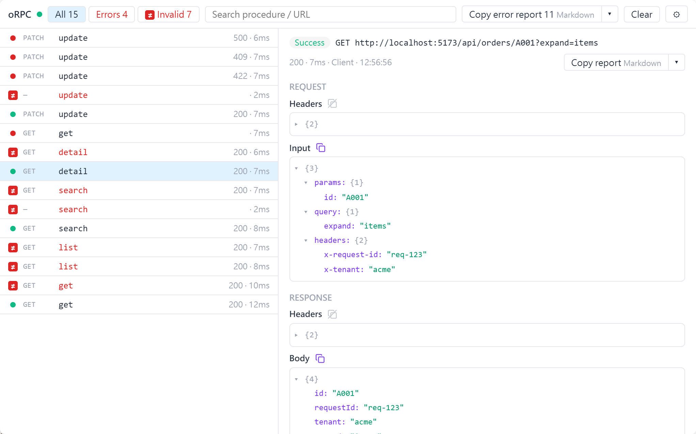
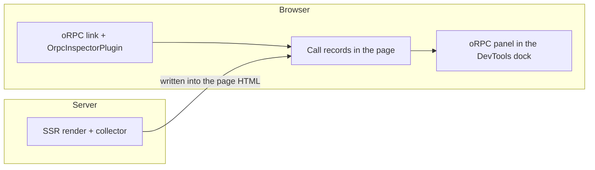

# How it works

English | [繁體中文](./how-it-works.zh-TW.md)

<picture>
  <source media="(prefers-color-scheme: dark)" srcset="../images/panel-calls-dark.png">
  
</picture>

1. `OrpcInspectorPlugin` on your oRPC link records each call (input, output, errors, headers) in the page.
2. During SSR, a collector records each request's calls and writes them into the page HTML. The page merges them on load.
3. The oRPC panel in the DevTools dock reads the records straight from the page.
4. Production builds get a no-op unless you [opt in](./production.md).

The inspector only watches the client side of the link, so the backend can be anything the link talks to.

## Terms

| Term | Meaning |
|---|---|
| Dock | The DevTools toolbar inside your page: Vite DevTools, or Nuxt DevTools v4. **oRPC** is one of its entries |
| Panel | The oRPC view. It only works inside the dock, not in its own tab |
| Auth code | A code the dev server prints. The dock asks for it the first time you open it |
| Side | Where a call ran: `client` or `ssr` |
| Collector | Records the SSR calls of one server request ([SSR](./ssr.md)) |
| No-op | What production builds get: the same API, doing nothing |
| Hub | The Vite DevTools files in a production build (`__devtools/`) |
