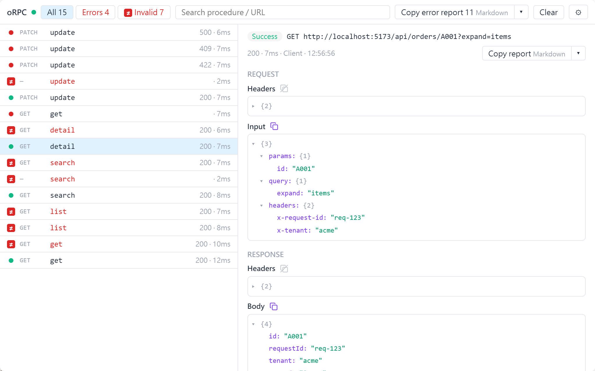
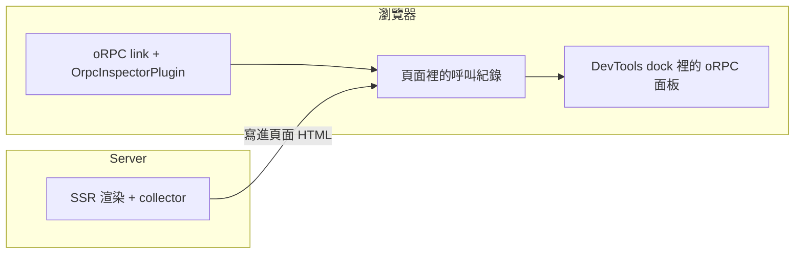

# 運作方式

[English](./how-it-works.md) | 繁體中文

<picture>
  <source media="(prefers-color-scheme: dark)" srcset="../images/panel-calls-dark.png">
  
</picture>

1. oRPC link 上的 `OrpcInspectorPlugin` 把每次呼叫（input、output、錯誤、headers）記在頁面裡。
2. SSR 時，collector 記下每個 request 的呼叫，寫進頁面 HTML；頁面載入時併入紀錄。
3. DevTools dock 裡的 oRPC 面板直接從頁面讀取紀錄。
4. production build 拿到 no-op，除非[自行開啟](./production.zh-TW.md)。

inspector 只看 link 的 client 端，所以後端可以是 link 連得到的任何 server。

## 用語

| 用語 | 意思 |
|---|---|
| Dock | 頁面裡的 DevTools 工具列：Vite DevTools 或 Nuxt DevTools v4。**oRPC** 是其中一個項目 |
| 面板 | oRPC 的檢視畫面。只能在 dock 裡用，不能在獨立分頁開 |
| 授權碼 | dev server 印出的碼。第一次開 dock 時會要求輸入 |
| Side | 呼叫在哪裡執行：`client` 或 `ssr` |
| Collector | 記錄一個 server request 裡的 SSR 呼叫（[SSR](./ssr.zh-TW.md)） |
| No-op | production build 拿到的版本：API 相同，但什麼都不做 |
| Hub | production build 裡的 Vite DevTools 檔案（`__devtools/`） |
