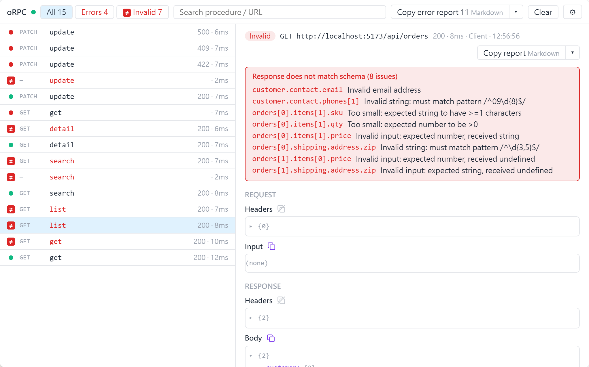

# Validation issues

English | [繁體中文](./validation.zh-TW.md)

See which fields failed validation, listed by path. The inspector shows the issues oRPC reports; it does not validate anything itself.

<picture>
  <source media="(prefers-color-scheme: dark)" srcset="../images/panel-validation-dark.png">
  
</picture>

## Where issues come from

| Source | What you see |
|---|---|
| Client validation, with any backend | Invalid input is marked *not sent*. A response that does not match the contract lists every field that failed |
| An oRPC server that rejects the input (`BAD_REQUEST` with `data.issues`) | Marked as rejected by the server, with the same field list |
| An oRPC server whose own output validation fails | A plain 500 with no issues ([oRPC: validation errors](https://orpc.dev/docs/advanced/validation-errors)) |

## Validate on the client

Define your API as an oRPC contract, then add [`RequestValidationPlugin`](https://orpc.dev/docs/plugins/request-validation) and [`ResponseValidationPlugin`](https://orpc.dev/docs/plugins/response-validation) to the link next to `OrpcInspectorPlugin`.

For example, with a REST backend (`pnpm add @orpc/openapi-client@^1.16.0`):

```ts
import type { ContractRouterClient } from '@orpc/contract'
import { createORPCClient } from '@orpc/client'
import { RequestValidationPlugin, ResponseValidationPlugin } from '@orpc/contract/plugins'
import { OpenAPILink } from '@orpc/openapi-client/fetch'
import { OrpcInspectorPlugin } from 'orpc-inspector'
import { contract } from './contract' // built with `oc` from @orpc/contract

const link = new OpenAPILink(contract, {
  url: `${location.origin}/api`,
  plugins: [
    new OrpcInspectorPlugin(),
    new RequestValidationPlugin(contract),
    new ResponseValidationPlugin(contract),
  ],
})

export const client: ContractRouterClient<typeof contract> = createORPCClient(link)
```

To show zod messages in your language, see [Translating zod messages](./zod-locale.md).
