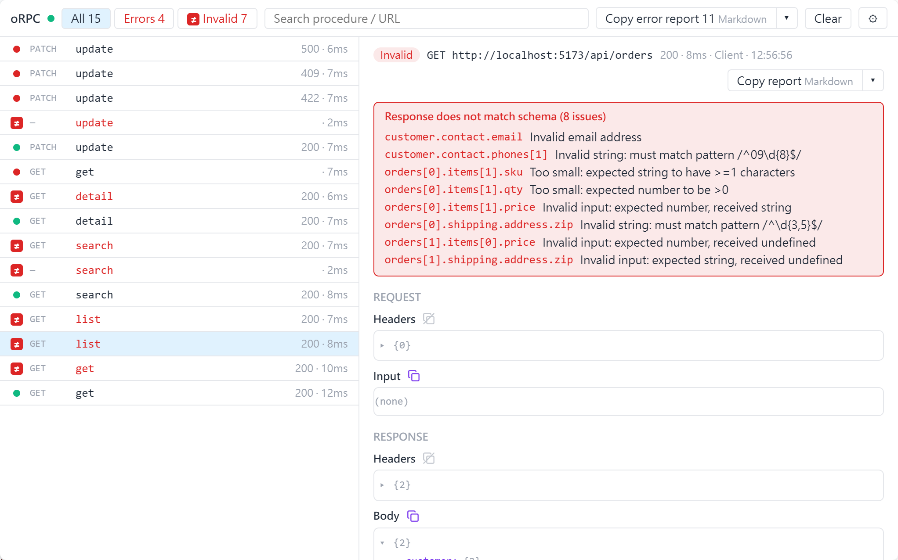

# 驗證問題

[English](./validation.md) | 繁體中文

依路徑列出哪些欄位驗證失敗。inspector 只顯示 oRPC 回報的驗證問題，本身不做驗證。

<picture>
  <source media="(prefers-color-scheme: dark)" srcset="../images/panel-validation-dark.png">
  
</picture>

## 驗證問題從哪裡來

| 來源 | 面板顯示 |
|---|---|
| client 端驗證，任何後端都可用 | 輸入不符時標成「未送出」；回應不符 contract 時，逐一列出不符的欄位 |
| oRPC server 拒絕輸入（`BAD_REQUEST` 加 `data.issues`） | 標成「伺服器拒絕了輸入」，同樣列出欄位 |
| oRPC server 自己的 output 驗證失敗 | 只有一般的 500，沒有 issues（[oRPC：validation errors](https://orpc.dev/docs/advanced/validation-errors)） |

## 在 client 端驗證

用 oRPC contract 定義 API，並在 link 的 `OrpcInspectorPlugin` 旁加上 [`RequestValidationPlugin`](https://orpc.dev/docs/plugins/request-validation) 與 [`ResponseValidationPlugin`](https://orpc.dev/docs/plugins/response-validation)。

例如接 REST 後端（`pnpm add @orpc/openapi-client@^1.16.0`）：

```ts
import type { ContractRouterClient } from '@orpc/contract'
import { createORPCClient } from '@orpc/client'
import { RequestValidationPlugin, ResponseValidationPlugin } from '@orpc/contract/plugins'
import { OpenAPILink } from '@orpc/openapi-client/fetch'
import { OrpcInspectorPlugin } from 'orpc-inspector'
import { contract } from './contract' // 用 @orpc/contract 的 `oc` 定義

const link = new OpenAPILink(contract, {
  url: `${location.origin}/api`,
  plugins: [
    new OrpcInspectorPlugin(),
    new RequestValidationPlugin(contract),
    new ResponseValidationPlugin(contract),
  ],
})

export const client: ContractRouterClient<typeof contract> = createORPCClient(link)
```

要把 zod 訊息顯示成你的語言，見[翻譯 zod 訊息](./zod-locale.zh-TW.md)。
